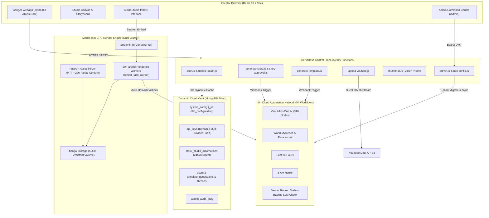

<div align="center">

# ⚡ Bang AI (BangAI Studio)
### *The Universal Autonomous Video Engine & Multi-Channel Media Studio*

<p align="center">
  <a href="https://bangai.netlify.app/"></a>
  
  
  
  
  
  
  
  
</p>

<p align="center">
  <b>Transform single-line prompts into viral 5-scene cinematic screenplays, neural voiceovers, dynamic smart-paced subtitles, and 1-click auto-published YouTube Shorts in under 75 seconds.</b>
</p>

<p align="center">
  <a href="#-overview">Overview</a> •
  <a href="#-core-feature-modules">Feature Modules</a> •
  <a href="#-system-architecture">Architecture</a> •
  <a href="#-stock-studio-cloud-render-engine">Stock Studio & Modal</a> •
  <a href="#-admin-command-center">Admin Control Plane</a> •
  <a href="#-security--zero-leak-architecture">Security Vault</a> •
  <a href="#-local-development">Quickstart</a>
</p>

---

</div>

## 🌐 Overview

**BangAI** is a cloud-native, end-to-end autonomous video creation platform built for creators, media enterprises, and automated channel networks. 

By unifying **serverless frontend orchestrators**, **n8n Cloud production pipelines**, a **Modal.com 20-worker GPU rendering cluster**, and a **dynamic MongoDB Atlas control plane**, BangAI delivers completely automated video production: from script generation and speech synthesis to stock footage composition, subtitle timing, and multi-channel YouTube publishing.

> [!NOTE]
> BangAI eliminates traditional video editing overhead. Every pipeline is engineered with zero-downtime hot swapping, intelligent fallback chains, and sub-second multi-tenant isolation.

---

## 🚀 Core Feature Modules

<table>
<tr>
<td width="50%" valign="top">

### 🎬 Autonomous AI Template Workflows
*1-Click Autonomous Video Pipelines*
- **4 Flagship Video Pipelines:**
  - *Viral All-In-One AI* (75s multi-scene Shorts)
  - *World Mysteries & Paranormal*
  - *Last 24 Hours*
  - *3-AM Horror*
- **Mathematical 5-Act Pacing:** Scene 1 Hook (25–27 words @ 1.30x), Scene 2 Tension, Scene 3 Peak Climax, Scene 4 Resolution, Scene 5 CTA.
- **Smart-Paced Subtitles:** Real-time phrase chunking (4–8 words) calibrated for natural speech rates (`12.2` chars/s Hindi, `15.0` chars/s English).
- **Strategy Brain:** Autonomously chooses fresh viral topics or accepts custom creator prompts.

</td>
<td width="50%" valign="top">

### ☁️ BangAI Stock Studio
*High-Concurrency Cloud Video Engine*
- **Modal.com 20-Worker GPU Cluster:** Parallel cloud rendering with active FIFO queue rank tracking (`Position #N`) and wait countdowns.
- **24-Hour Autopilot Engine:** Scheduled topic queues (`upcomingTopics` & `completedTopics`) with automatic dispatch and multi-channel YouTube upload.
- **HTTP 206 Partial Content Streaming:** Native byte-range video streaming via FastAPI for instant video scrubbing and playback without buffering freezes.
- **Strict Multi-Language Enforcement:** Authentic Hindi (`hi-IN`) and English voiceover scripting with synchronized Devanagari font rendering (`Nirmala.ttc`).
- **Bring-Your-Own-Key (BYOK) + Pool Mode:** Scoped per-user configuration at `/storage/users/{user_id}/`.

</td>
</tr>
<tr>
<td width="50%" valign="top">

### 🖼️ AI Thumbnail Studio
*High-CTR Visual Generation Engine*
- **Zero-Leak Serverless Vision Proxy:** Browser requests route through secure serverless endpoints with zero exposed vendor API keys.
- **Dynamic Kie.ai Key Pool:** Round-robin key rotation across 16 keys with automatic error fallback.
- **Reference Image Blending:** Direct base64 CDN upload with server-to-server dispatch for face-swapping and style matching.
- **Multi-Ratio Export:** Optimized 16:9 landscape and 9:16 vertical outputs.

</td>
<td width="50%" valign="top">

### 🔴 Multi-Channel YouTube & Google Sheets Hub
*Automated Distribution & Content Tracking*
- **Official Google OAuth 2.0 Integration:** Multi-channel YouTube account linking with silent background token refresh.
- **Resilient Upload Engine:** Chunked resumable streaming uploads with HTTP 308 slice recovery fallback.
- **Google Sheets Live Matrix:** 1-Click spreadsheet linking appending video titles, script beats, MP4 CDN links, and YouTube URLs in real time.
- **Multi-Account Governance:** Switch destination channels per workflow run.

</td>
</tr>
</table>

---

## 🏗️ System Architecture



---

## ☁️ Stock Studio Cloud Render Engine

The **BangAI Stock Studio** is deployed on **Modal.com** as a high-concurrency serverless microservice cluster designed to eliminate gateway timeouts and process multiple video renders simultaneously:

### Dual-Cluster High Availability
| Cluster Profile | Role | Web UI Endpoint | FastAPI Asset Server |
| :--- | :--- | :--- | :--- |
| **`cmpunktg`** | **Primary** | [`https://cmpunktg--bangai-stock-studio-ui.modal.run`](https://cmpunktg--bangai-stock-studio-ui.modal.run) | [`https://cmpunktg--bangai-stock-studio-serve.modal.run`](https://cmpunktg--bangai-stock-studio-serve.modal.run) |
| **`cmpunktg1`** | **Backup** | [`https://cmpunktg1--bangai-stock-studio-ui.modal.run`](https://cmpunktg1--bangai-stock-studio-ui.modal.run) | [`https://cmpunktg1--bangai-stock-studio-serve.modal.run`](https://cmpunktg1--bangai-stock-studio-serve.modal.run) |

### Key Technical Pillars
1. **20 Parallel Rendering Workers:** Configured via `max_containers=20` and `max_concurrent_tasks=20` on 4 vCPU / 8 GiB RAM worker containers.
2. **FIFO Queue & Dynamic Countdown:** When all 20 workers are active, incoming requests enter a thread-safe FIFO queue displaying real-time position badges (`Position #1`, `Position #2`) and live wait estimates.
3. **HTTP 206 Video Streaming:** Video playback utilizes FastAPI's RFC 7233 byte-range server (`Accept-Ranges: bytes`), bypassing Streamlit's in-memory Tornado buffer for instant timeline seeking.
4. **Multi-Tenant User Isolation:** Each user's tasks, media, and BYOK credentials are isolated in `/storage/users/{user_id}/` with thread-local scoping and cloud volume commit synchronization.

---

## 🎛️ Admin Command Center (`/admin`)

BangAI features a dedicated administrative control plane for platform governance, zero-downtime key rotation, and account migrations:

```
┌────────────────────────────────────────────────────────────────────────┐
│                      BANGAI COMMAND CENTER (/admin)                    │
│      Cyber-Glassmorphic UI • Master Auth Guard • Zero Code Edits       │
├────────────────────────────┬───────────────────────────────────────────┤
│ 🔄 1-Click 14-Day Migrator │ Automated export, credential sanitizing,  │
│                            │ and batch import across n8n instances     │
├────────────────────────────┼───────────────────────────────────────────┤
│ 🔑 Dynamic API Key Vault   │ Live balance checking & latency probes    │
│                            │ for Kie.ai, json2video, LLM, CloudConvert │
├────────────────────────────┼───────────────────────────────────────────┤
│ ⚡ Universal Cloud Control  │ 1-Click batch "Publish All" & "Unpublish" │
│                            │ across all production workflows           │
├────────────────────────────┼───────────────────────────────────────────┤
│ 📊 Real-Time Logs Gallery  │ Live MP4 CDN streaming & direct YouTube   │
│                            │ links inspection with creator analytics   │
├────────────────────────────┼───────────────────────────────────────────┤
│ 🤖 Stock Studio Autopilot  │ 24h queue monitor, manual run dispatch,   │
│                            │ and connected YouTube channel inspector   │
└────────────────────────────┴───────────────────────────────────────────┘
```

---

## 🛡️ Security & Zero-Leak Architecture

BangAI operates on a hardened **Two-Tier Secrets Architecture** guaranteeing zero client-side credential exposure:

```
Tier 1: Netlify Infrastructure Environment
├── MONGODB_URI (Atlas cluster connection)
├── JWT_SECRET (Session token signing)
├── GOOGLE_CLIENT_ID & GOOGLE_CLIENT_SECRET (OAuth Partner tokens)
└── SHORTSAI_WEBHOOK_SECRET (Inter-service authentication)

Tier 2: MongoDB Atlas Dynamic Vault (system_config & api_keys)
├── Dynamic LLM Pools (Gemini 2.5 Flash, GPT-5.1, Groq, DeepSeek)
├── Dynamic Vision Pools (16 Kie.ai Thumbnail keys)
├── Dynamic Audio Pools (json2video ElevenLabs keys, CloudConvert, Zvid)
└── n8n Dynamic Webhook Registry (Active instance switching via single doc)
```

- **Client DevTools Safe:** Browser network tabs only inspect local relative paths (`/.netlify/functions/...`). Minified bundle files contain **zero plaintext vendor API keys**.
- **Automated Failover:** When a third-party key hits a rate limit (HTTP 429) or insufficient quota (HTTP 402), serverless proxies automatically rotate to the next key in the pool.

---

## 💻 Tech Stack

- **Frontend:** [React 18](https://react.dev/), [Vite 5](https://vitejs.dev/), [Lucide React](https://lucide.dev/), Vanilla CSS (Modern OLED Dark `#07080D`, Glassmorphic Cyber Glow, GPU micro-animations).
- **Serverless Backend:** [Netlify Functions](https://www.netlify.com/products/functions/) (Node.js ESM, JWT HMAC-SHA256, Mongo Native Driver).
- **GPU Cloud Compute:** [Modal.com](https://modal.com/) (Python 3.11, FastAPI, Streamlit, MoviePy, FFmpeg, Edge-TTS).
- **Workflow Automation:** [n8n Cloud](https://n8n.io/) (JSON-RPC SSE MCP, Webhook routers, dynamic backup nodes).
- **Database & Secrets:** [MongoDB Atlas](https://www.mongodb.com/atlas) (Collections: `system_config`, `api_keys`, `stock_studio_automations`, `template_generations`, `threads`, `users`, `admin_audit_logs`).

---

## ⚙️ Configuration & Environment Variables

To configure the application, provide the following variables in your Netlify or local environment:

| Variable | Description |
| :--- | :--- |
| `MONGODB_URI` | MongoDB Atlas connection string |
| `JWT_SECRET` | Secret key for signing session JWT tokens |
| `GOOGLE_CLIENT_ID` | Google Cloud OAuth 2.0 Client ID for YouTube & Google Sheets |
| `GOOGLE_CLIENT_SECRET` | Google Cloud OAuth 2.0 Client Secret |
| `N8N_WEBHOOK_URL` | Fallback primary n8n webhook URL *(Dynamic instance resolved from Atlas)* |
| `SHORTSAI_WEBHOOK_SECRET` | Shared HMAC secret for webhook authorization |

> [!TIP]
> Third-party vendor keys (Kie.ai, json2video, ElevenLabs, Gemini, etc.) do not need to be hardcoded in environment variables; they are managed dynamically through the **Admin Command Center** and stored in MongoDB Atlas.

---

## 🚀 Local Development

### Prerequisites
- [Node.js](https://nodejs.org/) (v18.0.0 or higher)
- [npm](https://www.npmjs.com/) or [pnpm](https://pnpm.io/)
- A free [MongoDB Atlas](https://www.mongodb.com/atlas) cluster

### Setup
```bash
# 1. Clone the repository
git clone https://github.com/Suzainkhan-SK/BangAI.git
cd BangAI

# 2. Install dependencies
npm install

# 3. Create local environment file
cp .env.example .env
# Fill in your MONGODB_URI and JWT_SECRET in .env

# 4. Start local development server
npm run dev

# 5. Build for production
npm run build
```

---

<div align="center">

**BangAI Studio** • Autonomous Video Infrastructure for the Modern Creator Economy  
*Built with precision, speed, and mathematical storytelling.*

</div>
